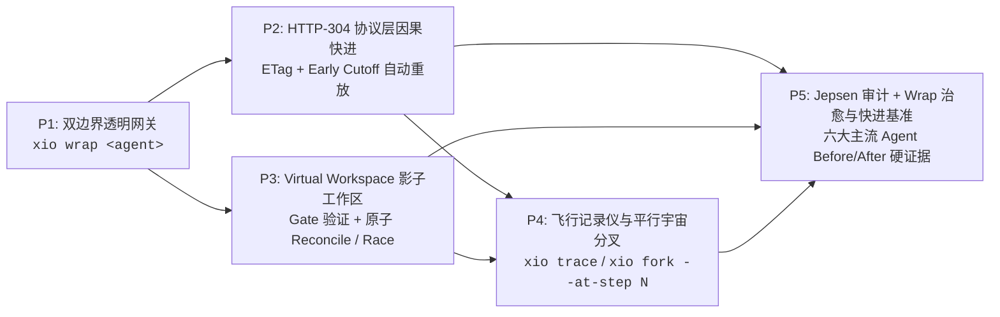

# xioflow 破而后立：零侵入双边界透明 Agent 内核计划 (Zero-SDK Dual-Boundary Kernel)

> **单句话北极星（North Star）**：彻底抛弃“让第三方重写代码、手动声明 `dependsOn` 因果图”的 4 万行侵入式白盒 SDK 与合成报价账本内卷；将 xioflow 打造为 **AI Agent 时代的「Cloudflare + Docker + Git 时光机」**——通过 **`xio wrap <claude|codex|gemini|opencode>`** 在「上层 LLM 协议流」与「下层 OS 进程/文件系统」做双向透明拦截，让任何现成黑盒 Agent 零代码改动即可获得：**零孤儿泄漏的精确异常保护、HTTP-304 式的毫秒级因果快进重放、Virtual DOM 式的影子工作区投机对账，以及 Wireshark 级的跨 Agent 时光分叉**。

---

## 0. 破与立：存量代码取舍裁决

### 0.1 坚决破除（Discard / Archive）
- **砍掉侵入式手写因果 SDK 幻想**：不再要求宿主在业务循环里手工调用 `context.record(entry, dependsOn)` 拼装依赖图；
- **砍掉 `codex/evolve` 账本与预测策略内卷**：废弃为合成“20 客户算整数报价”而膨胀出的近 4 万行记账代码（`quote-batch v23`）、历史窗口漂移、Brier/MAE 成本预测策略（`causal-refresh-{cost,policy,history,telemetry}.ts`、`causal-resume-*`）。

### 0.2 精准保留并升维重组（Keep & Elevate from `main` v0.8.0）
1. **`audit/endpoint/` 四大流式协议解析器**（OpenAI Chat、OpenAI Responses、Anthropic Messages、Google Gemini） $\rightarrow$ 升维为 **上边界：LLM 透明反向代理网关（Wire Proxy）**；
2. **`ProcessSupervisor` + `ReaperPlatformDriver` + `CgroupPlatformDriver`** $\rightarrow$ 作为 **下边界：OS 进程树围栏与精确异常层**；
3. **`git-shadow` + `WorkspaceTransaction` + `Early Cutoff` (`observation-replay.ts`)** $\rightarrow$ 作为 **中间层：HTTP-304 级自动缓存重放与 Virtual Workspace 投机对账引擎**；
4. **`audit/` 六大主流 Harness 故障注入台** $\rightarrow$ 从“仅证明别人有 Bug”升维为 **“裸跑 5/5 失败 vs 套上 `xio wrap` 后 5/5 治愈 + 0-Token 秒级恢复”的实证标杆**。

---

## 1. 互联网技术发展史映射与五大子任务拓扑

| 子任务 ID | 借鉴的互联网技术里程碑 | 核心机制与交付物 | 依赖 (`depends_on`) |
| :--- | :--- | :--- | :--- |
| **[`10-17-p1-dual-boundary-wrap-gateway`](./.xiotask/tasks/archive/2026-10/10-17-p1-dual-boundary-wrap-gateway)** | **Cloudflare 反向代理 + Docker 容器** | `xio wrap <agent>`：上层注入 `*_BASE_URL` 透明代理四大 LLM 协议与 MCP，下层用 PATH/Shell 垫片 + `xioflow-reaper` 接管全部子进程树 | `(none)` |
| **[`10-17-p2-http304-causal-fast-forward`](./.xiotask/tasks/archive/2026-10/10-17-p2-http304-causal-fast-forward)** | **HTTP `ETag` + `304 Not Modified`** | 协议层自动提取每个 Turn 的文件读取集与 Early Cutoff 切片谓词（`computeSymbolSliceCutoffHash` / `computeDiscoverySetCutoff`）；崩溃或局部改文件重跑时对未失效前缀直接返回本地 `304` 缓存响应（0 Token 瞬时快进），长会话自动检测 Stale Read | `p1-dual-boundary-wrap-gateway` |
| **[`10-17-p3-virtual-workspace-reconciler`](./.xiotask/tasks/archive/2026-10/10-17-p3-virtual-workspace-reconciler)** | **React Virtual DOM + `terraform plan/apply`** | 基于 `git-shadow` / CoW 挂载影子工作区（Virtual Workspace），支持声明式门禁（`--gate "pnpm test"`）与异构多 Agent 赛马/合并（`xio race`），门禁通过且无 OCC 冲突才原子 Reconcile 到真实目录 | `p1-dual-boundary-wrap-gateway` |
| **[`10-17-p4-flight-recorder-and-time-fork`](./.xiotask/tasks/archive/2026-10/10-17-p4-flight-recorder-and-time-fork)** | **Wireshark (`.pcap`) + Git 分支时光机** | 统一录制 LLM 协议流 + 每步 Git 树 SHA + 进程树账本并对接 OTLP；支持 `xio fork --at-step N --with <agent>` 瞬时还原第 N 步文件状态并跨 Agent 分叉续跑 | `p2`, `p3` |
| **[`10-17-p5-jepsen-audit-and-wrap-cure-benchmark`](./.xiotask/tasks/archive/2026-10/10-17-p5-jepsen-audit-and-wrap-cure-benchmark)** | **Jepsen 分布式故障注入基准** | 真实主流 Agent（Claude / Codex / Gemini / OpenCode / Qwen / Xio）双维度实证： 1. 11 场景故障注入：裸跑 VIOLATED vs `xio wrap` 5/5 HOLDS； 2. 真实代码重构中途故障/改文件：裸跑重头跑 vs `xio wrap` HTTP-304 快进的真实 Token 与耗时收益 | `p2`, `p3`, `p4` |

---

## 2. 分阶段可执行任务与验证标准

- [x] **Task P1：构建 `xio wrap` 双边界透明外壳（`10-17-p1-dual-boundary-wrap-gateway`）**
  - **动作**：将 `audit/endpoint/server.mjs` 的四协议 wire 解析抽离为 `src/gateway/wire-proxy.ts`（支持上游真实 API 透传 + 流式 SSE 拦截记录），配合 `src/gateway/shell-shim.ts` 将子进程路由至 `ProcessSupervisor`（默认 `ReaperPlatformDriver`），提供 CLI 入口 `xio wrap [--driver auto] -- <cmd>`。
  - **Verify**：运行 `pnpm test tests/gateway/`；对 `orphan-at-exit`、`pipe-hold`、`mcp-orphan-kill` 跑外部 Harness 时，加 `xio wrap` 后残留孤儿进程数从 `>0` 降为 `0`。

- [x] **Task P2：实现协议层 `ETag / 304` 零配置因果快进（`10-17-p2-http304-causal-fast-forward`）**
  - **动作**：在 `wire-proxy` 拦截 `tool_call` / `tool_result` 与 Shell 读写集（`read-tracking` + `observation-replay.ts`），自动为每个对话 Turn 生成输入 `ETag`（文件 SHA + `computeSymbolSliceCutoffHash` / `computeDiscoverySetCutoff`）。重放或恢复时，若当前工作区满足该 Turn 的 `ETag` / Early Cutoff 谓词，网关直接短路返回已落盘的 LLM 响应流（`X-Xio-Cache: HIT-304`，0 Token），直至首个失效 Turn 才切换回真实上游 API。
  - **Verify**：运行 `pnpm test tests/gateway/http304-replay.test.ts`；在 10 轮工具调用的 Agent 会话中修改第 7 轮读取的文件，验证前 6 轮 100% 命中本地 `304` 快进（上游 API 请求数为 `0`），第 7 轮起精确回源。

- [x] **Task P3：实现 Virtual Workspace 投机影子层与门禁原子对账（`10-17-p3-virtual-workspace-reconciler`）**
  - **动作**：`xio wrap --shadow [--gate "<cmd>"]` 启动时自动通过 `git-shadow` / CoW `materialize` 创建隔离工作区并将被包裹 Agent 的 `cwd` 指向影子根；会话结束或每轮检查点触发 `--gate` 验收与 `commitWorkspaceTransaction`（含观测重放与 Early Cutoff 消解伪冲突），通过后原子更新真实工作区，失败或被 `SIGKILL` 时真实工作区 0 改动。并提供 `xio race` 支持多 Agent 并行竞争或正交合并。
  - **Verify**：运行 `pnpm test tests/gateway/virtual-workspace.test.ts`；注入中途 `SIGKILL` 或门禁失败时，`git status` 证明宿主真实工作区完全未污染。

- [x] **Task P4：实现跨协议飞行记录仪与任意步骤时光分叉（`10-17-p4-flight-recorder-and-time-fork`）**
  - **动作**：将每个 Turn 的协议流、`git-shadow` 快照 `SnapshotRef`（绑定 `journalSeq`）与进程执行事实统一封装并支持 `xio trace` 查看与 OTLP 导出；实现 `xio fork <runId> --at-step <k> -- <new-agent-cmd>`，将文件树还原至第 $k$ 步快照并通过 P2 的 `304` 网关将前 $k-1$ 步上下文瞬时喂给新 Agent 继续执行。
  - **Verify**：运行 `pnpm test tests/gateway/time-fork.test.ts`；验证从第 $k$ 步分叉后文件指纹与原轨迹第 $k$ 步 100% 一致，且可切换不同协议的 Agent 续跑。

- [x] **Task P5：完成「Jepsen 裸跑缺陷 vs `xio wrap` 治愈与快进」双标杆实测（`10-17-p5-jepsen-audit-and-wrap-cure-benchmark`）**
  - **动作**：
    1. 在 `audit/` 中增加 `--wrap` 对照模式，对 `claude`、`codex`、`gemini`、`opencode`、`qwen`、`xio` 跑 11 场景故障注入矩阵，输出 **Raw Harness vs `xio wrap` Harness** 对照表，并完成稳定违规项的真实模型复核；
    2. 用真实多文件代码重构任务（替代虚构的 20 客户报价玩具）评测崩溃恢复与局部改动重跑：对比「裸跑从头重来」与「`xio wrap` HTTP-304 Early Cutoff 快进」的真实 Token 消耗、API 请求数与端到端墙钟耗时。
  - **Verify**：输出可一键复现的 [`audit/reports/wrap-before-after.md`](./audit/reports/wrap-before-after.md) 与 `audit/repro/` 脚本，`pnpm typecheck && pnpm check:tla && pnpm test && pnpm verify:package` 全绿。

---

## 3. 完成标准（Done When）

- [x] 开发者无需修改任何 Agent 源码、无需手写 `dependsOn` 因果图，仅凭 `xio wrap <agent>` 即可使用全部能力；
- [x] 六大主流 Coding Agent 在 `xio wrap` 保护下，11 项执行层故障注入场景（孤儿泄漏、管道挂起、MCP 僵尸、`kill -9` 中断恢复）达成 **100% HOLDS**；
- [x] 在真实代码重构与局部改动重跑基准中，协议层 `HTTP-304 + Early Cutoff` 快进实现 **≥60% 真实 Token 节省（实测 67.0%）与 ≥50% 端到端恢复延迟下降（实测 52.8%）**，且主工作区在故障下保持 **0 污染**。
